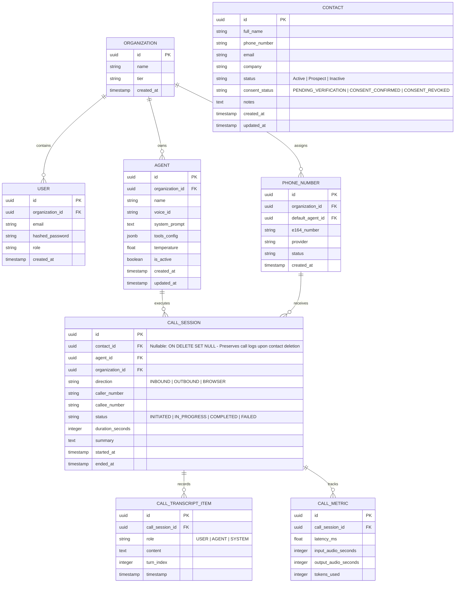

# Voxora Architecture Blueprint

Voxora is an enterprise-grade AI voice calling platform engineered for high-concurrency real-time conversational agents, telephone dispatching, and contact center intelligence.

---

## 1. System Overview & High-Level Architecture

Voxora divides functionality into two complementary real-time voice delivery pipelines sharing unified agent definitions, persistence, and evaluation pipelines:

```
+-----------------------------------------------------------------------------------+
|                                  USER / CLIENT                                    |
|                                                                                   |
|    +-----------------------------+             +-----------------------------+    |
|    |   Web Browser (Operator)    |             |   Public Switched Phone Net |    |
|    |   - Dashboard & Agent Config|             |   (PSTN / Mobile Callers)   |    |
|    |   - Web Audio WebSockets    |             |                             |    |
|    +--------------+--------------+             +--------------+--------------+    |
+-------------------|-------------------------------------------|-------------------+
                    |                                           |
                    | HTTPS/WSS                                 | SIP / Media Streams
                    v                                           v
+------------------------------------+          +-----------------------------------+
|      Voxora Frontend (Next.js)     |          | Telephony Gateway (Twilio/Telnyx) |
|  - App Router / React / TS         |          | - Inbound/Outbound PSTN trunking  |
|  - Enterprise UI (Charcoal & Gold) |          | - Bidirectional Media Stream WSS  |
+-------------------+----------------+          +-----------------+-----------------+
                    |                                             |
                    | REST & WebSocket Relay                      | WSS (Bi-directional Audio)
                    v                                             v
+-----------------------------------------------------------------------------------+
|                          Voxora Backend Service (FastAPI)                         |
|                                                                                   |
|  [ API Layer ]                                                                    |
|  - /api/v1/agents      (Agent configuration, voice parameters, system prompts)    |
|  - /api/v1/calls       (Call initiation, status, transcripts, analytics)          |
|  - /api/v1/telephony   (Webhook receivers, Call dispatch, TwiML/TeXML generation)  |
|  - /ws/browser-audio   (Low-latency audio streaming for web browser microphone)   |
|  - /ws/telephony-media (Low-latency audio streaming for PSTN phone calls)         |
|                                                                                   |
|  [ Orchestration & Session Engine ]                                               |
|  - Audio resampler & chunker (PCM 16-bit / 8kHz telephony <-> 24kHz Gemini Live)   |
|  - Context Manager (Dynamic agent prompts, tool execution, customer metadata)     |
|  - Turn-taking & Interrupt detector (Barge-in handling)                           |
+-------------------+---------------------------------------------+-----------------+
                    |                                             |
       Bidirectional WSS (gRPC / Live API)            SQLAlchemy / asyncpg
                    v                                             v
+------------------------------------+          +-----------------------------------+
|       Gemini Live Audio API        |          |        PostgreSQL Database        |
|  - Low-latency speech-to-speech    |          |  - Organizations & Users          |
|  - Native multimodal reasoning     |          |  - Agent Prompts & Voice Settings |
|  - Function calling / Tool use     |          |  - Call Logs, Metrics, & Billing  |
+------------------------------------+          +-----------------------------------+
```

---

## 2. Browser Voice vs. Real Telephone Calls

Voxora treats browser voice and phone calls as distinct ingress adapters to a shared conversational core.

| Aspect | Web Browser Voice (Testing & Agent Console) | Real Telephone Calls (PSTN / Telephony) |
| :--- | :--- | :--- |
| **Transport** | Browser `AudioContext` & WebSocket (`WSS`) | SIP trunk via Telephony Provider (Twilio/Telnyx) streaming over WebSocket |
| **Audio Format** | Linear PCM 16-bit or 24-bit, 16kHz / 24kHz / 48kHz mono | Standard telephony G.711 $\mu$-law (PCMU) or 16-bit PCM at 8,000 Hz mono |
| **Latency Budget** | Ultra-low (150ms – 300ms roundtrip) | Telecom hop + AI processing (400ms – 700ms roundtrip) |
| **Latency Criticality**| Low jitter, direct client-to-server connection | Packet jitter buffer, strict 20ms frame delivery required |
| **Use Cases** | Agent configuration, sandbox prompt testing, operator assist | Customer support dispatch, inbound customer hotlines, sales qualification |
| **Authentication** | JWT Session / OAuth Bearer token in WebSocket handshake | Webhook cryptographic signature verification (e.g., Twilio HMAC-SHA256 signature) |

---

## 3. Frontend & Backend Responsibilities

### Frontend (`Next.js App Router`, React, Tailwind CSS)
1. **Agent Configuration Suite:**
   - Define agent identities: system instructions, temperature, voice persona, interruption sensitivity.
   - Tool/action builder: specify external APIs the agent is allowed to invoke during calls.
2. **Interactive Audio Studio:**
   - Real-time visualizer (waveform/activity indicator) using Web Audio API without neon or distracting effects.
   - Low-latency bidirectional audio capture and playback via browser microphone/speakers.
3. **Telephony Management:**
   - Provisioned telephone number management (inbound routing rules).
   - Single-call dispatch dialog (e.g. initiating outbound call with an active agent persona).
4. **Call Records & Analytics:**
   - Historical call logs: duration, completion status, latency metrics, sentiment, structured summaries.
   - Transcript explorer with audio playback aligned with spoken turns.

### Backend (`Python / FastAPI`)
1. **State & Orchestration Service:**
   - Manage conversational lifecycle (Call initiation $\rightarrow$ Ringing $\rightarrow$ In-progress $\rightarrow$ Disconnected $\rightarrow$ Analysis).
   - Bridge audio streams between clients (Browser / Telephony Provider) and Gemini Live API.
2. **Audio Transcoding:**
   - Bidirectional real-time transcoding between Telephony $\mu$-law 8kHz and Gemini Live PCM 16kHz/24kHz.
3. **Tool Execution:**
   - Handle model function-call triggers (e.g. check booking availability, record customer address, escalate to human).
4. **Data Persistence & Analytics:**
   - Persist calls, transcripts, usage metrics, and audit events into PostgreSQL via SQLAlchemy.
5. **Security & Signature Verification:**
   - Validate incoming provider webhook signatures to prevent unauthorized API trigger abuse.

---

## 4. Gemini Live API Integration Plan

The Gemini Live API enables native audio-in to audio-out real-time conversation without traditional STT $\rightarrow$ LLM $\rightarrow$ TTS latency cascades.

### Streaming Protocol
- **Connection:** Asynchronous bidirectional WebSocket connection initiated by Voxora backend to Gemini Live API endpoints.
- **Client Uplink:** Voxora backend streams raw chunked PCM audio from the user (telephony or browser) directly to Gemini.
- **Downlink:** Gemini streams raw PCM audio chunks and function calls back to Voxora backend.
- **Interruption Handling (Barge-in):**
  When human speech is detected while the agent is speaking:
  1. Backend receives interruption signal or detects incoming audio energy above threshold.
  2. Backend immediately sends a cancel/stop frame to Gemini and flushes the client's outbound audio playback buffer.
  3. Conversational context is updated to maintain conversational continuity.

---

## 5. Telephony Provider & Webhook Integration Plan

Voxora is engineered to be telephony-agnostic, supporting standard WebSocket media streaming (e.g., Twilio Media Streams, Telnyx TeXML Media Streaming).

### Inbound Call Sequence
1. Customer dials a Voxora-managed telephone number.
2. Provider issues an HTTP POST webhook to `/api/v1/telephony/inbound`.
3. Voxora validates the cryptographic webhook signature.
4. Voxora responds with instructions (TwiML / TeXML `<Connect><Stream>` tag) directing the provider to open a bidirectional WebSocket stream to `/ws/telephony-media/{call_session_id}`.
5. Audio frames flow bidirectionally between the phone and Gemini Live via Voxora's session engine.
6. Upon hangup, provider calls `/api/v1/telephony/status` to report call duration, termination cause, and call metrics.

---

## 6. PostgreSQL Data Model Plan



---

## 7. Authentication and Authorization Plan

1. **Role-Based Access Control (RBAC):**
   - **Super Admin:** Full platform visibility and organizational management.
   - **Admin:** Manages company agents, phone numbers, API keys, and team members.
   - **Operator:** Can initiate browser voice testing sessions, view call logs, and read transcripts.
   - **Auditor:** Read-only access to analytics and historical call compliance data.
2. **API & Telephony Authentication:**
   - Web API: JWT tokens via `Authorization: Bearer <token>` with short expirations and refresh token rotation.
   - Webhooks: Constant-time signature verification matching the telephony provider's HMAC key.
   - WebSockets: Ticket-based or query-parameter token verification resolved before upgrading the connection.

---

## 8. Secrets & Privacy Protections

- **Secret Management:** All credentials (`GEMINI_API_KEY`, `DATABASE_URL`, `TELEPHONY_AUTH_TOKEN`) are sourced strictly from environment variables. None are committed to git or exposed to the client.
- **Audio Privacy:** Audio streams are processed in memory and never written to plain, unprotected storage unless explicit call recording is configured.
- **PII Scrubbing:** Transcripts can run through redaction pipelines before persistent storage to obscure credit card numbers, national identification numbers, and passwords.
- **Encryption:**
  - In-transit: TLS 1.3 for all web traffic; WSS for all audio streaming.
  - At-rest: AES-256 database column encryption for sensitive API keys and provider credentials.

---

## 9. Local Development & Deployment Strategy

### Local Environment Setup
- **Frontend:** Node.js 20+ / 24+ running Next.js dev server on port `3000`.
- **Backend:** Python 3.11+ / 3.13+ running FastAPI via `uvicorn` on port `8000`.
- **Database:** Local PostgreSQL instance or Docker container on port `5432`.
- **Reverse Tunnel (for Telephony Webhooks):** ngrok or cloudflared tunnel pointing to `localhost:8000` to receive provider callbacks during active call testing.

### Deployment Path (Production Target)
- **Frontend:** Vercel or containerized Next.js on AWS ECS / Google Cloud Run.
- **Backend:** High-throughput containerized FastAPI workers with ASGI asynchronous event loop running on Google Cloud Run or AWS ECS with sticky WebSocket support.
- **Database:** Managed PostgreSQL (e.g. Google Cloud SQL or AWS Aurora PostgreSQL) with SSL enforcement and connection pooling via PgBouncer.


---

## 10. Analytics & Telemetry Engine (Phase 7)

### Architecture and Data Privacy
1. **Zero Transcript Ingestion:** Analytics queries strictly select scalar columns from `call_sessions` (`status`, `duration_seconds`, `started_at`). Raw conversation turn text (`call_transcripts`) is never loaded into memory during metrics calculations, maintaining privacy and sub-millisecond execution times.
2. **Formula Specifications:**
   - **Total Sessions:** \(N_{\text{total}} = \sum \text{Sessions in Date Range}\)
   - **Completed Sessions:** \(N_{\text{completed}} = \sum (\text{status} = \text{'COMPLETED'})\)
   - **Failed Sessions:** \(N_{\text{failed}} = \sum (\text{status} = \text{'FAILED'})\)
   - **Incomplete / Dropped Sessions:** \(N_{\text{incomplete}} = N_{\text{total}} - N_{\text{completed}} - N_{\text{failed}}\)
   - **Completion Rate:** \(\text{Rate} = \frac{N_{\text{completed}}}{N_{\text{total}}} \times 100\) (yields `0.0` if \(N_{\text{total}} = 0\))
   - **Average Duration of Completed Sessions:** \(\text{AvgDuration} = \frac{\sum_{i \in \text{Completed}, d_i > 0} d_i}{N_{\text{Completed}, d_i > 0}}\) (yields `0.0` if no completed sessions have valid duration)
3. **RFC 4180 CSV Streaming:**
   - Real-time generation via Python `csv.writer` with minimal quoting, escaping embedded quotes (`""`), commas, and line breaks.
   - Headers: `Session ID`, `Contact Name`, `Phone / Audio Source`, `Direction`, `Status`, `Duration (Seconds)`, `Started At (UTC)`, `Ended At (UTC)`, `Agent Name`, `Summary`.
   - Never exposes API keys, tokens, or environment credentials.


---

## 11. Settings, Agent Persona & Security Guardrails (Phase 8)

### Configuration Architecture
1. **Database Persistence:** System settings are stored in `system_settings` (primary key `"default"`). In the current single-tenant workspace architecture, settings are shared across operator sessions. Multi-tenant user isolation is staged for subsequent RBAC phases.
2. **AI Engine Integration:**
   - Saved settings (`agent_name`, `response_style`, `language`, `custom_instructions`) are dynamically loaded by the conversation processing endpoint.
   - History context is strictly capped to the configured `max_history_turns` (bounded between 2 and 20 turns) to prevent context overflows and denial-of-service.
   - Temperature is constrained between 0.0 and 1.0.
3. **Immutable Server Safety Directives:**
   - Operator custom instructions are appended to base persona definitions.
   - Strict `SERVER_MANDATORY_SAFETY_RULES` are unconditionally appended at the end of the system instruction sent to Gemini.
   - This prevents user-editable instructions from overriding server controls, making outbound calls, or executing external transactions.
4. **Credential Security:**
   - `GEMINI_API_KEY` is loaded exclusively on the backend server.
   - Neither the API key nor credential fragments appear in API responses, logs, or client-side production bundles.
   - The `/security-status` endpoint audits platform guardrail integrity without exposing secrets.
5. **Safe Reset Policy:**
   - The `reset_settings` service resets persona, speech rate, and temperature back to factory defaults.
   - Call history, transcripts, audio durations, and contacts are explicitly preserved and never modified or deleted during a settings reset.

---

## 12. Telephony Subsystem & Safe Carrier Abstraction (Phase 9)

### Architecture and Abstraction Layer
The Telephony Subsystem introduces vendor-neutral telephony dispatching and bidirectional audio readiness while maintaining strict isolation between real PSTN carrier billing and development sandboxes.

```
+-------------------------------------------------------------------------------+
|                           Voxora Frontend Dispatcher                          |
|  - Destination Validation (E.164) & Emergency Blocklist Indicator             |
|  - Mandatory Consent & Authorized Operator Checkboxes                         |
|  - Carrier Status Badge (Mock Sandbox / Carrier Live)                         |
+---------------------------------------+---------------------------------------+
                                        | POST /api/v1/telephony/calls
                                        v
+-------------------------------------------------------------------------------+
|                        FastAPI Telephony Gateway Layer                        |
|                                                                               |
|  [ Security & Guardrail Pipeline ]                                            |
|  1. Affirmative Consent & Operator Authorization Verification                 |
|  2. Destination Blacklist Check: Rejects Emergency & Premium Service Numbers  |
|  3. Sliding-Window Rate Limiter (Max 5 outbound calls per minute)             |
|  4. Active Destination Collision Lock (Rejects concurrent calls to same num)  |
|                                                                               |
|  [ Factory & Provider Abstraction ]                                           |
|                     +----------------------------------+                      |
|                     |      BaseTelephonyProvider       |                      |
|                     |  - initiate_call()               |                      |
|                     |  - terminate_call()              |                      |
|                     |  - get_call_status()             |                      |
|                     |  - verify_webhook_signature()    |                      |
|                     +-----------------+----------------+                      |
|                                       |                                       |
|             +-------------------------+-------------------------+             |
|             v                                                   v             |
|  +---------------------+                             +---------------------+  |
|  | MockProvider        |                             | TwilioProvider      |  |
|  | - Zero carrier cost |                             | - REST Trunking     |  |
|  | - Safe deterministic|                             | - HMAC-SHA1 Signatures |
|  |   lifecycle         |                             | - Bidirectional WSS |  |
|  +---------------------+                             +---------------------+  |
+---------------------------------------+---------------------------------------+
                                        |
                                        v
+-------------------------------------------------------------------------------+
|                       Session Persistence & Call History                      |
|  - Stores `provider_call_id` and `telephony_provider` in `call_sessions`      |
|  - Real-time status synchronization and duration tracking                     |
|  - Graceful call termination releases active locks                            |
+-------------------------------------------------------------------------------+
```

### Regulatory Compliance & Jurisdictional Handling

1. **India TRAI & DoT PSTN Bypass Restrictions:**
   - **Regulatory Rule:** Under TRAI (Telecom Regulatory Authority of India) and DoT guidelines, bridging VoIP/data networks directly into the public switched telephone network (PSTN) without a licensed Unified Access Service Provider (UASP) infrastructure is illegal (PSTN Interconnect Bypass).
   - **DLT Mandate:** Outbound enterprise calling requires Distributed Ledger Technology (DLT) entity registration, registered headers (Sender IDs), and approved telemarketing series (e.g., 140-series prefixes).
   - **Enforcement:** Voxora defaults to `MockTelephonyProvider` (`TELEPHONY_ENABLE_REAL_CALLS=False`) unless certified carrier infrastructure with domestic Indian SIP peering is explicitly configured.

2. **US / Canada FCC 10DLC & STIR/SHAKEN:**
   - **A2P 10DLC:** Requires registered Brand and Campaign IDs to originate automated calls and messages to North American numbers.
   - **STIR/SHAKEN:** Calls must originate from cryptographic-attested numbers (Attestation Level A) to avoid carrier spam tagging or automated drop.
   - **TCPA Compliance:** Explicit consent must be recorded prior to initiating any automated or AI voice communications.

### Safety Guardrails

- **Universal Emergency Number Blacklisting:** The platform strictly blocks calling emergency numbers across jurisdictions: `911`, `112`, `100`, `101`, `102`, `108`, `999`, `988`, `000`, `110`, `119`. Rejections occur at both the Pydantic schema validation layer and the `TelephonySecurityManager` security barrier.
- **Sliding-Window Rate Limiting:** A sliding 60-second in-memory rate limiter caps outbound dispatching to a maximum of 5 calls per minute across the platform.
- **Concurrent Active Collision Lock:** Prevents dialing the same destination phone number concurrently while an active call session is already `in-progress` or `ringing`.
- **Double-Affirmative Checkboxes:** Outbound calls require explicit frontend operator confirmation: `consent_confirmed: true` and `authorization_confirmed: true`. Unchecked requests return HTTP 400 Bad Request.

### Media Streaming Bridge Architecture (SIP/RTP to WebSocket)

For live real-time conversations over PSTN:
1. When an outbound call is answered, Twilio executes TwiML `<Connect><Stream url="wss://voxora.example.com/ws/telephony-media" />`.
2. The bi-directional WebSocket streams audio frames encoded in G.711 $\mu$-law (8kHz 8-bit mono).
3. The Voxora backend resamples G.711 $\mu$-law to 16-bit linear PCM (16kHz / 24kHz) for Gemini Live API ingestion.
4. Gemini speech responses are converted back to G.711 $\mu$-law at 20ms frame intervals (160 bytes per packet) and piped directly into the carrier WebSocket.

---

## 13. Production Deployment & Hosting Topology (Phase 10)

### Production Topology Overview
```
+-------------------------------------------------------------------------------+
|                       Tier 1: Global Edge (Vercel)                            |
|  - Next.js 15 App Router Frontend                                            |
|  - Prerendered static shells + dynamic client hydration                      |
|  - Safe public environment variables only (NEXT_PUBLIC_API_URL)               |
|  - HTTPS / TLS 1.3 automated certificate termination                         |
+---------------------------------------+---------------------------------------+
                                        | HTTPS / REST & WSS
                                        v
+-------------------------------------------------------------------------------+
|                 Tier 2: Asynchronous Application Core (Render)                |
|  - Containerized Python 3.13 / FastAPI service (Dockerfile / render.yaml)     |
|  - Port-bound ASGI Uvicorn workers with proxy header forwarding              |
|  - Host health probe: GET /health and GET /api/v1/health                     |
|  - Server-side Gemini API integration (GEMINI_API_KEY never in browser)       |
|  - Telephony abstraction gateway & webhook signature verification            |
+---------------------------------------+---------------------------------------+
                                        | postgresql+asyncpg:// (SSL Enforced)
                                        v
+-------------------------------------------------------------------------------+
|                     Tier 3: Managed Database (PostgreSQL)                     |
|  - Managed PostgreSQL instance (Render DB / Supabase / Neon / AWS RDS)        |
|  - Connection pooling via asyncpg (min_size=5, max_size=20)                  |
|  - Non-destructive startup schema migrations (check_and_migrate)              |
|  - Point-in-time recovery (PITR) & automated daily WAL snapshots              |
+-------------------------------------------------------------------------------+
```

### Database Persistence & Backup Strategy
1. **Dialect Normalization:** The backend automatically transforms standard `postgres://` or `postgresql://` connection strings into `postgresql+asyncpg://` for non-blocking asynchronous execution.
2. **Schema Resilience:** Tables (`call_sessions`, `call_transcripts`, `contacts`, `system_settings`) are created idempotently at application startup via `Base.metadata.create_all`. Backward-compatible column additions are verified safely without data loss.
3. **Disaster Recovery & Backups:**
   - Production instances should enable automated daily logical dumps via `pg_dump`:
     ```bash
     pg_dump -Fc --no-acl --no-owner -h <host> -U <user> -d <dbname> > voxora_backup_$(date +%Y%m%d).dump
     ```
   - Retention policy: 7 daily snapshots, 4 weekly snapshots, 12 monthly archives in encrypted object storage (S3 / GCS).


